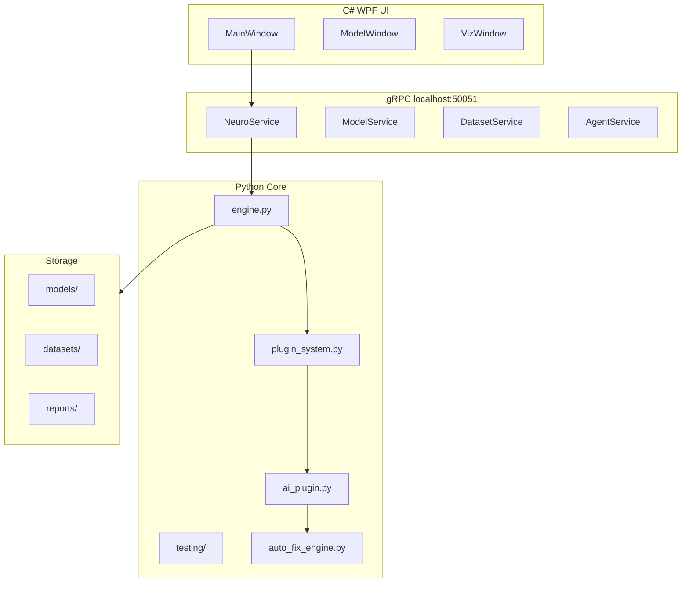

# 🏗️ ARCHITECTURE - NeuroConstructor

## 📋 Protocol Definitions

### Service: NeuroService
- `Chat` → echo + history
- `GetStatus` → model_loaded, model_path, gpu_layers
- `ListModels` → список загруженных моделей

### Service: DatasetService (NEW - Stage 5+)
- `ListTemplates`, `CreateDataset`

### Service: ModelService (Stage 4-5)
- `CreateEmptyGGUF`, `SaveModel`, `Prune`, `ExportModel`

### Plugin System
- `PluginCategory` (10 типов)
- `PluginStatus` (6 статусов)
- `PluginInterface` → `execute()`
- `PluginManager` → `register()`, `execute()`, `cleanup()`

## 🔧 Recent Changes (Stage 5-6)

| File | Change | Status |
|---|---|---|
| `plugin_system.py` | Полная реализация плагиновой системы | ✅ Complete |
| `ai_plugin.py` | AI Prediction Plugin (Stage 6) | ✅ Created |
| `auto_fix_engine.py` | AutoFix Engine (Stage 6) | ✅ Created |
| `testing/*.py` | 3 файла тестовой инфраструктуры | ✅ Created |
| `PROJECT_STATUS_REPORT.md` | Обновлён с 🚀 Перспективами | ✅ Updated |
